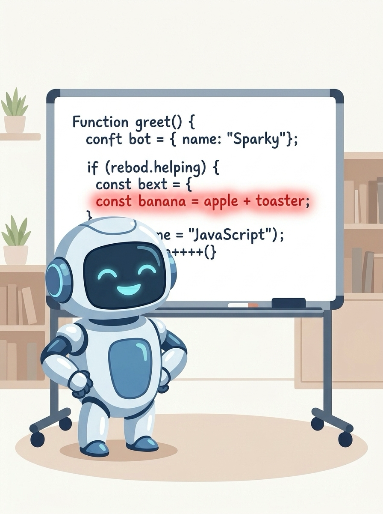

<!-- _class: lead -->

# Programação Web I
## IA como parceira de estudo (sem terceirizar o cérebro)

Prof. Pablo Werlang
pablowerlang@ifsul.edu.br

---

# IA na Programação Web
## Ela já está na sua mesa

<div class="grid grid-cols-3 gap-6">
<div class="col-span-2">

- Está no VS Code, no navegador e no celular
- Escreve, explica e corrige código em segundos
- A pergunta não é **se** você vai usar
- A pergunta é: ela te deixa **mais capaz** ou **mais dependente**?

Hoje vamos aprender a usar a IA para **aprender mais**, não para pensar menos.

</div>
<div class="media flex items-center h-full">
    
</div>
</div>

---

<!-- _class: divider -->

# O que a IA é (e o que não é)

---

# O que a IA é
## Uma máquina de prever texto muito boa

<div class="grid grid-cols-3 gap-6">
<div class="col-span-2">

- Aprendeu padrões lendo uma quantidade enorme de texto e código
- Gera a resposta **mais provável**, não necessariamente a correta
- No chat, ela só vê o que você cola; com **agentes**, pode ler a sua pasta e rodar o seu código
- Mesmo assim, não sabe o que o professor pediu nem o que você já aprendeu
- Quando não sabe, pode **inventar com total confiança**

</div>
<div class="media flex items-center h-full">
    
</div>
</div>

---

# O que a IA é
## Quando ela "alucina"

Você pergunta como remover uma tarefa da lista e recebe:

```javascript
const tarefas = ['Estudar DOM', 'Fazer exercício', 'Dormir'];
tarefas.removeAt(1); // TypeError: tarefas.removeAt is not a function
```

O método não existe. O jeito que vimos em aula:

```javascript
tarefas.splice(1, 1); // resultado: ['Estudar DOM', 'Dormir']
```

Quem estudou arrays percebe o erro na hora. Quem só copiou, não.

---

<!-- _class: divider -->

# Academia para o cérebro

---

# Academia para o cérebro
## A empilhadeira na academia

<div class="grid grid-cols-3 gap-6">
<div class="col-span-2">

- Levar uma empilhadeira para a academia levanta o peso...
- ...mas quem fica forte é a empilhadeira, não você
- O exercício de aula não existe para **produzir código**
- Ele existe para **treinar o seu raciocínio**
- O código pronto é o peso; o aprendizado é o músculo

</div>
<div class="media flex items-center h-full">
    
</div>
</div>

---

# Academia para o cérebro
## Muleta ou treinador?

<div class="grid grid-cols-2 gap-6">
<div>

**IA como muleta**

- "Faz o exercício de localStorage pra mim"
- Copia, cola, entrega
- Funciona, mas você não sabe por quê
- Na prova, trava

</div>
<div>

**IA como treinador**

- "Por que meu item some ao recarregar?"
- Recebe uma pista e tenta de novo
- Entende o `JSON.stringify` que faltava
- Na prova, resolve sozinho

</div>
</div>

---

<!-- _class: divider -->

# Cinco jeitos de usar bem

---

# Jeito 1
## Professor particular

Peça explicação, não solução. Use exemplos do seu nível.

```text
Estou aprendendo JavaScript puro, sem frameworks.
Explique o que o addEventListener faz como se eu
tivesse 15 anos. Use uma analogia do dia a dia e
NÃO escreva o código do meu exercício.
```

- Peça outra analogia se a primeira não fez sentido
- Peça para comparar com algo que você já conhece

---

# Jeito 2
## Tutor que só faz perguntas

Em vez de pedir a resposta, peça para ser guiado.

```text
Meu fetch está mostrando [object Promise] na tela.
Não me dê a resposta. Faça uma pergunta de cada
vez até eu descobrir sozinho o que está errado.
```

- Você chega à resposta pelo próprio raciocínio
- É mais lento, e é justamente por isso que funciona
- Na próxima vez, você reconhece o problema sozinho

---

# Jeito 3
## Detetive de erros

<div class="grid grid-cols-2 gap-6">
<div>

O console mostrou:

```text
Uncaught TypeError: Cannot read
properties of null (reading
'addEventListener')
```

Pergunte: **"O que essa mensagem significa?"**

</div>
<div>

- A IA traduz o erro para português
- Você descobre que o `querySelector` não achou o elemento
- Talvez o script rodou antes do HTML existir
- Talvez você tenha escrito o seletor errado
- Talvez o elemento não existe no HTML
- Agora a correção é **sua**

</div>
</div>

---

# Jeito 4
## Revisor depois que funcionou

Primeiro você faz. Depois pede uma segunda opinião.

```text
Este é o meu insertuser.php. Ele já funciona.
O que um professor criticaria aqui? Aponte os
problemas, mas não reescreva o arquivo inteiro.
```

- Pode apontar SQL montado com concatenação (perigo!)
- Pode lembrar que faltou o `header('Content-Type: application/json')`
- Você decide o que corrigir, e corrige com as suas mãos

---

# Jeito 5
## Gerador de treino

Usou a IA para criar **mais exercício**, não para fugir dele.

```text
Crie 3 desafios curtos de localStorage parecidos
com uma lista de tarefas. Um fácil, um médio e um
difícil. Não mostre as soluções.
```

- Ótimo para revisar antes da prova
- Peça também um quiz de 5 perguntas sobre o conteúdo
- Depois peça para ela **corrigir as suas respostas**

---

# Bons prompts
## A anatomia de um pedido útil

<div class="grid grid-cols-2 gap-6">
<div>

- **Contexto:** "aula de Programação Web, JS puro"
- **Objetivo:** "entender por que..."
- **Limite:** "sem me dar o código pronto"
- **Formato:** "em 3 passos curtos"

</div>
<div>

```text
Sou estudante de PW1 e uso
JavaScript puro, sem frameworks.
Quero entender por que minha
lista não aparece após o fetch.
Não me dê o código pronto.
Explique em 3 passos curtos.
```

</div>
</div>

Quanto melhor o contexto, menos a IA precisa adivinhar.

---

<!-- _class: divider -->

# Agentes de código

---

# Agentes de código
## Do chat ao agente

<div class="grid grid-cols-3 gap-6">
<div class="col-span-2">

- O **chat** responde com texto; quem copia e testa é você
- O **agente** trabalha direto no seu projeto: lê arquivos, edita, roda comandos
- Alguns nomes: **Codex**, **Claude Code**, **GitHub Copilot**, **Antigravity**, **OpenCode**
- Vivem no terminal, no VS Code ou em um editor próprio
- Em segundos, conseguem fazer um exercício inteiro... e é aí que mora o perigo

</div>
<div class="media flex items-center h-full">
    
</div>
</div>

---

# Agentes de código
## Como um agente trabalha

<div class="grid grid-cols-2 gap-6">
<div>

1. Lê o seu pedido
2. Explora a pasta e abre os arquivos
3. Monta um plano
4. Edita um ou vários arquivos
5. Roda comandos para testar
6. Mostra o que mudou (o **diff**)

</div>
<div>

- Cada passo pode precisar da sua **aprovação**
- O diff mostra linha por linha o que entrou e saiu
- Se você aprova tudo sem ler, quem programou foi o agente
- O objetivo é você entender cada passo, não só ver o resultado

</div>
</div>

---

# Agentes de código
## O agente como colega de estudo

Peça para ele **ler e explicar**, sem mexer em nada:

```text
Leia a pasta 05-local-storage/agenda-contatos.
Explique o caminho de um contato: do formulário
até o localStorage e de volta para a tela.
Não altere nenhum arquivo.
```

- Use o modo de **planejamento** ou de **pergunta**, quando existir
- Peça para ele explicar um diff antes de você aceitar
- Peça um exercício novo numa pasta separada, sem solução

---

# Agentes de código
## Instruções que o agente lê antes de começar

Este repositório tem um arquivo `AGENTS.md`. A maioria dos agentes lê esse arquivo antes de trabalhar:

```markdown
- Prefer solutions that are clear for students
- Vanilla JS with direct DOM APIs
- Do not introduce frameworks or new dependencies
- comments in PT-BR
```

- É como um "combinado da turma" escrito para a IA
- Você pode criar o seu: "explique antes de editar", "não use frameworks"

---

# Agentes de código
## Regras de segurança

<div class="grid grid-cols-3 gap-6">
<div class="col-span-2">

- Faça um **commit** antes de chamar o agente: o Git é a sua rede de proteção
- Leia cada diff antes de aceitar
- Não aprove comandos que você não entende, principalmente `rm`, `sudo` ou instalações
- Deixe `.env` e senhas fora do alcance do agente
- No fim, rode o projeto e teste com as suas próprias mãos

</div>
<div class="media flex items-center h-full">
    
</div>
</div>

---

<!-- _class: divider -->

# Os limites

---

# Os limites
## Sinais de alerta

- A resposta usa React, jQuery ou algo que não vimos em aula
- Você não consegue explicar o código linha por linha
- "Funcionou", mas você não sabe dizer **por quê**
- O código é muito maior ou mais "chique" do que o exercício pede
- Você já não lembra a última vez que leu o erro no console

**Teste do colega:** se não consegue explicar para quem senta ao lado, ainda não aprendeu.

---

# Os limites
## Privacidade e segurança

<div class="grid grid-cols-3 gap-6">
<div class="col-span-2">

- Tudo o que você cola pode ficar guardado no serviço
- **Nunca** cole senhas; e lembre que um agente pode ler o `.env` e o `connection.php`
- Não cole dados pessoais de colegas, como nome, e-mail ou telefone
- Troque dados reais por exemplos: "Ana", "ana@exemplo.com"
- Confira o código antes de rodar, principalmente o que mexe no banco

</div>
<div class="media flex items-center h-full">
    
</div>
</div>

---

# Os limites
## Honestidade acadêmica

- Na prova, quem programa é você: sem IA
- Nos trabalhos, combine com o professor o que é permitido
- Se usou IA, **diga como usou**: isso não é vergonha, é transparência
- Você é o autor e o responsável por cada linha entregue

Regra de ouro: **se você não consegue explicar, não entregue.**

---

# Os limites
## O semáforo da IA

<div class="grid grid-cols-3 gap-6">
<div>

**🟢 Pode usar**

- Explicar um conceito
- Traduzir uma mensagem de erro
- Criar quiz e desafios extras
- Revisar o que você já fez

</div>
<div>

**🟡 Com cuidado**

- Pedir um trecho de exemplo
- Comparar duas soluções
- Pedir a "dica final"

Leia, feche e reescreva sozinho.

</div>
<div>

**🔴 Não use**

- Fazer o exercício inteiro
- Resolver a prova
- Colar senhas ou dados de colegas
- Entregar o que não entende

</div>
</div>

---

# Na prática
## Travei no exercício. E agora?

<div class="grid grid-cols-2 gap-6">
<div>

1. Tente por 15 minutos de verdade
2. Leia o erro no console (F12)
3. Consulte o README do exercício
4. Pergunte à IA pedindo **uma pista**
5. Implemente você mesmo
6. Explique a solução em voz alta

</div>
<div class="media flex items-center h-full">
    
</div>
</div>

---

# Na prática
## Desafio para a próxima aula

Escolha um exercício que você **já resolveu**, como `04-dom/lista-tarefas` ou `05-local-storage/agenda-contatos`.

1. Peça para a IA ser sua **tutora de perguntas** sobre esse código
2. Anote as 3 perguntas mais difíceis que ela fez
3. Peça um desafio novo, parecido, **sem solução**
4. Resolva o desafio sem pedir o código pronto

Traga as perguntas para discutirmos em aula.

---

# IA como parceira de estudo
## Resumo

<div class="grid grid-cols-3 gap-6">
<div class="col-span-2">

- A IA prevê texto: ela erra e inventa com confiança
- O exercício treina **você**, não a ferramenta
- Use como professor, tutor, detetive, revisor e gerador de treino
- Com agentes: commit antes, leia cada diff depois
- Proteja seus dados e respeite as regras de cada atividade
- Você está no volante; a IA é o copiloto

</div>
<div class="media flex items-center h-full">
    
</div>
</div>
